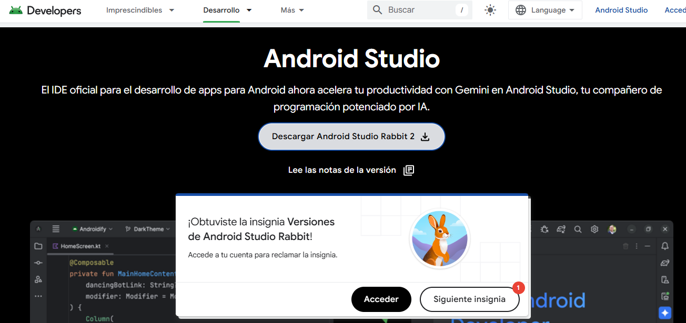
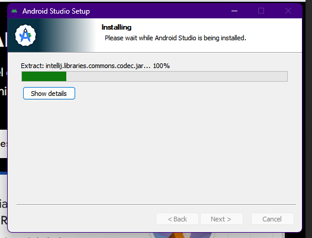
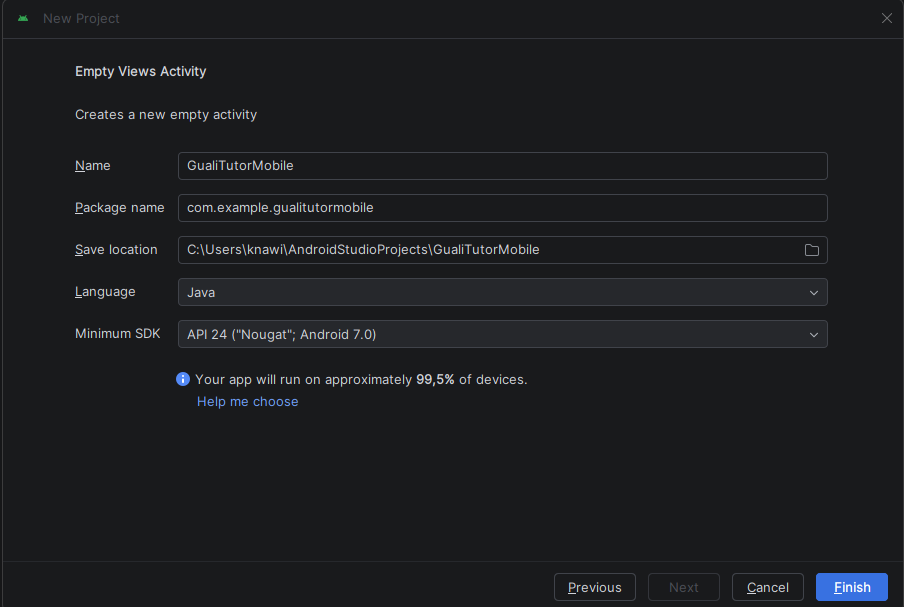
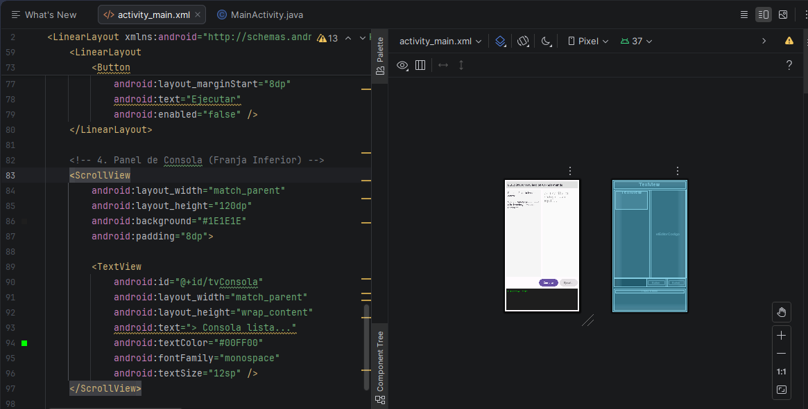
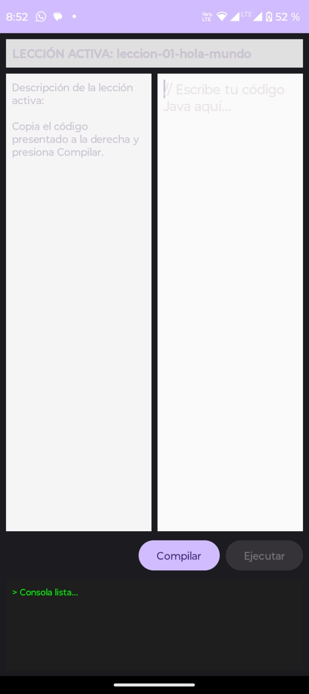
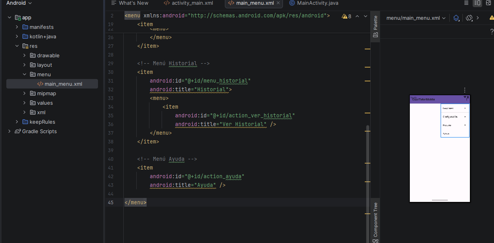
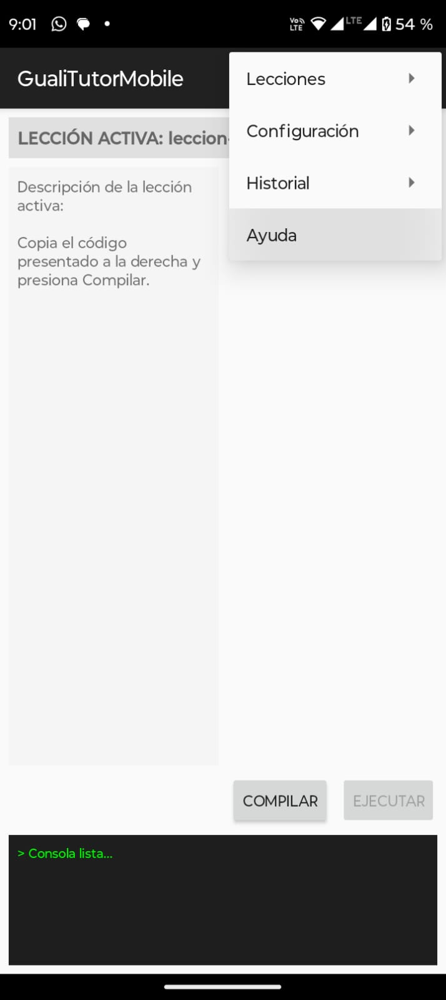
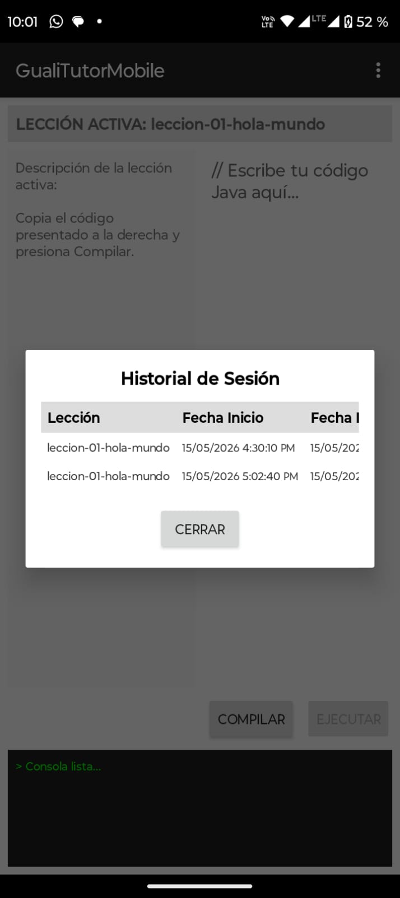
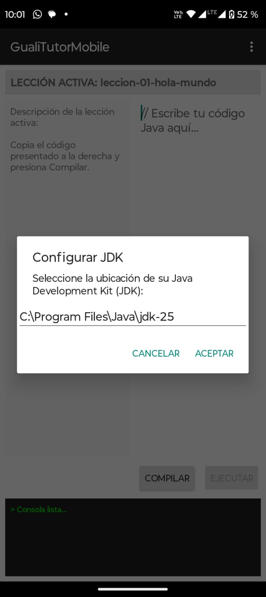

# Tutorial: Creación del Front-End Móvil - Guali Tutor (Fase 3)

**Estudiante:** José Eduardo Canahuí Canahuí  
**Carné:** 3190-25-2877
**Seccion:** "E"
**Curso:** Programación 2 - Universidad Mariano Gálvez de Guatemala  

---
## 1 Prerrequisitos y Software Necesario

Para construir y ejecutar la aplicación móvil **Guali Tutor**, es necesario contar con un entorno de desarrollo adecuadamente configurado. A continuación se detallan las herramientas requeridas y su proceso de instalación:

### Software Necesario

| Herramienta | Versión Recomendada | Función en el Proyecto |
| :--- | :--- | :--- |
| **Android Studio** | Rabbit 2 (o superior) | Entorno de desarrollo integrado (IDE) oficial para construir la app móvil. |
| **Java Development Kit (JDK)** | JDK 25 | Kit de desarrollo de Java base para el compilador y entorno del proyecto. |
| **Android SDK & Build Tools** | API 34+ | Bibliotecas y herramientas para compilar la interfaz de usuario en Android. |
| **Dispositivo Android Físico** | Android 7.0+ (API 24+) | Dispositivo de pruebas conectado vía USB (permite ahorrar espacio y memoria en la PC). |

---

### 1.1 Pasos de Instalación y Configuración

#### Paso 1: Instalación de Android Studio
1. Descargue el instalador oficial desde [developer.android.com](https://developer.android.com/studio).
2. Ejecute el instalador `android-studio-rabbit2-windows.exe` y seleccione la instalación estándar (**Standard**).
3. Acepte las licencias del SDK para iniciar la descarga automática de los componentes del motor Android.
4. *(Opcional - Ahorro de espacio)*: Una vez finalizada la instalación, elimine el archivo `.exe` descargado para liberar ~1.5 GB de almacenamiento.



## 2. Creación del Proyecto en Android Studio

Para iniciar con el desarrollo del Front-End móvil de **Guali Tutor**, se creó un nuevo proyecto utilizando la plantilla base y la configuración estándar especificada para el curso:

### Pasos Realizados

1. **Selección de la Plantilla:**
   - Se abrió Android Studio y se seleccionó la opción **New Project**.
   - En la categoría *Phone and Tablet*, se eligió la plantilla **Empty Views Activity**.

2. **Configuración de Parámetros del Proyecto:**
   - **Name:** `GualiTutorMobile`
   - **Language:** `Java` *(Seleccionado para mantener coherencia con la sintaxis utilizada en las Fases 1 y 2)*
   - **Minimum SDK:** `API 24 (Android 7.0)` o superior.
   - **Build Configuration Language:** `Groovy DSL` (o Kotlin DSL predeterminado).

3. **Sincronización Inicial:**
   - Se presionó el botón **Finish** para iniciar la generación de la estructura de archivos e importar las dependencias iniciales mediante el gestor de construcción **Gradle**.



## 3. Maquetación de la Interfaz Principal (XML)

En este paso se diseñó la estructura visual de la aplicación móvil en el archivo `activity_main.xml`, replicando las secciones principales solicitadas en el prototipo del proyecto:

### Estructura de la Interfaz

1. **Título de Lección Activa (`TextView`):** Encabezado superior que muestra el nombre de la lección seleccionada.
2. **Panel de Lección Activa (`ScrollView` con `TextView`):** Columna central izquierda encargada de mostrar la descripción e instrucciones de la lección.
3. **Editor de Código (`EditText`):** Columna central derecha con fuente monoespaciada (`monospace`) y soporte multilínea para la escritura manual de código Java.
4. **Botones de Acción (`Button`):** Botones de **Compilar** y **Ejecutar** alineados a la derecha.
5. **Panel de Consola (`ScrollView` con `TextView`):** Franja inferior con estilo de terminal (fondo oscuro `#1E1E1E` y texto verde `#00FF00`) para visualizar las salidas y errores.

### Código XML Completo (`activity_main.xml`)

```xml
<?xml version="1.0" encoding="utf-8"?>
<LinearLayout xmlns:android="http://schemas.android.com/apk/res/android"
    android:layout_width="match_parent"
    android:layout_height="match_parent"
    android:orientation="vertical"
    android:padding="8dp">


    <!-- 1. Título de la Lección Activa -->
    <TextView
        android:id="@+id/tvTituloLeccion"
        android:layout_width="match_parent"
        android:layout_height="wrap_content"
        android:text="LECCIÓN ACTIVA: leccion-01-hola-mundo"
        android:textStyle="bold"
        android:textSize="16sp"
        android:padding="8dp"
        android:background="#E0E0E0" />

    <!-- Área Central Dividida (Panel de Lección + Editor de Código) -->
    <LinearLayout
        android:layout_width="match_parent"
        android:layout_height="0dp"
        android:layout_weight="1"
        android:orientation="horizontal"
        android:layout_marginTop="8dp">

        <!-- 2. Panel de Lección Activa (Columna Izquierda) -->
        <ScrollView
            android:layout_width="0dp"
            android:layout_height="match_parent"
            android:layout_weight="1"
            android:background="#F5F5F5"
            android:padding="8dp">

            <TextView
                android:id="@+id/tvDescripcionLeccion"
                android:layout_width="match_parent"
                android:layout_height="wrap_content"
                android:text="Descripción de la lección activa:\n\nCopia el código presentado a la derecha y presiona Compilar."
                android:textSize="14sp" />
        </ScrollView>

        <!-- 3. Editor de Código (Columna Derecha) -->
        <EditText
            android:id="@+id/etEditorCodigo"
            android:layout_width="0dp"
            android:layout_height="match_parent"
            android:layout_weight="1"
            android:layout_marginStart="8dp"
            android:gravity="top|start"
            android:hint="// Escribe tu código Java aquí..."
            android:inputType="textMultiLine"
            android:fontFamily="monospace"
            android:background="#FAFAFA"
            android:padding="8dp" />
    </LinearLayout>

    <!-- Botones de Acción (Compilar y Ejecutar) -->
    <LinearLayout
        android:layout_width="match_parent"
        android:layout_height="wrap_content"
        android:orientation="horizontal"
        android:gravity="end"
        android:layout_marginTop="8dp"
        android:layout_marginBottom="8dp">

        <Button
            android:id="@+id/btnCompilar"
            android:layout_width="wrap_content"
            android:layout_height="wrap_content"
            android:text="Compilar" />

        <Button
            android:id="@+id/btnEjecutar"
            android:layout_width="wrap_content"
            android:layout_height="wrap_content"
            android:layout_marginStart="8dp"
            android:text="Ejecutar"
            android:enabled="false" />
    </LinearLayout>

    <!-- 4. Panel de Consola (Franja Inferior) -->
    <ScrollView
        android:layout_width="match_parent"
        android:layout_height="120dp"
        android:background="#1E1E1E"
        android:padding="8dp">

        <TextView
            android:id="@+id/tvConsola"
            android:layout_width="match_parent"
            android:layout_height="wrap_content"
            android:text="> Consola lista..."
            android:textColor="#00FF00"
            android:fontFamily="monospace"
            android:textSize="12sp" />
    </ScrollView>

</LinearLayout>
```





## 4. Creación de la Barra de Menú Superior

Se implementó el archivo de recursos de menú `res/menu/main_menu.xml` para incluir las opciones navegables especificadas en el prototipo del sistema:

* **Lecciones:** Opciones para *Abrir Lección* y *Cerrar Lección*.
* **Configuración:** Opción para *Configurar JDK*.
* **Historial:** Opción para *Ver Historial*.
* **Ayuda:** Opción de ayuda e instrucciones al usuario.

### Código XML del Menú (`main_menu.xml`)

```xml
<?xml version="1.0" encoding="utf-8"?>
<menu xmlns:android="[http://schemas.android.com/apk/res/android](http://schemas.android.com/apk/res/android)">
    <item android:id="@+id/menu_lecciones" android:title="Lecciones">
        <menu>
            <item android:id="@+id/action_abrir_leccion" android:title="Abrir Lección" />
            <item android:id="@+id/action_cerrar_leccion" android:title="Cerrar Lección" />
        </menu>
    </item>
    <item android:id="@+id/menu_configuracion" android:title="Configuración">
        <menu>
            <item android:id="@+id/action_configurar_jdk" android:title="Configurar JDK" />
        </menu>
    </item>
    <item android:id="@+id/menu_historial" android:title="Historial">
        <menu>
            <item android:id="@+id/action_ver_historial" android:title="Ver Historial" />
        </menu>
    </item>
    <item android:id="@+id/action_ayuda" android:title="Ayuda" />
</menu>
```



## Paso 5: Implementación de Diálogos Flotantes (JDK e Historial)

En este paso configuraremos las ventanas emergentes (*Dialogs*) para la configuración del JDK y el panel de Historial de Sesión, tal como lo especifican los prototipos del sistema.

---

### 5.1. Creación de la Interfaz del Historial (`dialog_historial.xml`)

Creamos una vista layout modal con un `HorizontalScrollView` que contenga una `TableLayout` para mostrar los registros de la sesión y un botón para cerrar el diálogo.

1. Ve a **`app` ➔ `src` ➔ `main` ➔ `res` ➔ `layout`**.
2. Crea un nuevo archivo de recurso de layout llamado **`dialog_historial.xml`**.
3. agrega este código XML:

```xml
<?xml version="1.0" encoding="utf-8"?>
<LinearLayout android:layout_height="wrap_content" android:layout_width="match_parent" android:orientation="vertical" android:padding="16dp" xmlns:android="[http://schemas.android.com/apk/res/android](http://schemas.android.com/apk/res/android)">

    <TextView android:gravity="center" android:layout_height="wrap_content" android:layout_marginBottom="12dp" android:layout_width="match_parent" android:text="Historial de Sesión" android:textColor="#000000" android:textSize="18sp" android:textStyle="bold"/>

    <!-- Contenedor con Scroll Horizontal -->
    <HorizontalScrollView android:layout_height="wrap_content" android:layout_width="match_parent">

        <TableLayout android:layout_height="wrap_content" android:layout_width="wrap_content">

            <!-- Encabezados de la Tabla -->
            <TableRow android:background="#DDDDDD" android:padding="6dp">
                <TextView android:paddingEnd="12dp" android:text="Lección" android:textColor="#000000" android:textStyle="bold"/>
                <TextView android:paddingEnd="12dp" android:text="Fecha Inicio" android:textColor="#000000" android:textStyle="bold"/>
                <TextView android:paddingEnd="12dp" android:text="Fecha Fin" android:textColor="#000000" android:textStyle="bold"/>
                <TextView android:text="Resultado" android:textColor="#000000" android:textStyle="bold"/>
            </TableRow>

            <!-- Registros de Prueba -->
            <TableRow android:padding="6dp">
                <TextView android:paddingEnd="12dp" android:text="leccion-01-hola-mundo" android:textColor="#333333" android:textSize="12sp"/>
                <TextView android:paddingEnd="12dp" android:text="15/05/2026 4:30:10 PM" android:textColor="#333333" android:textSize="11sp"/>
                <TextView android:paddingEnd="12dp" android:text="15/05/2026 4:35:43 PM" android:textColor="#333333" android:textSize="11sp"/>
                <TextView android:text="Pendiente" android:textColor="#FF0000" android:textSize="12sp" android:textStyle="bold"/>
            </TableRow>

            <TableRow android:padding="6dp">
                <TextView android:paddingEnd="12dp" android:text="leccion-01-hola-mundo" android:textColor="#333333" android:textSize="12sp"/>
                <TextView android:paddingEnd="12dp" android:text="15/05/2026 5:02:40 PM" android:textColor="#333333" android:textSize="11sp"/>
                <TextView android:paddingEnd="12dp" android:text="15/05/2026 5:03:25 PM" android:textColor="#333333" android:textSize="11sp"/>
                <TextView android:text="Completada" android:textColor="#008000" android:textSize="12sp" android:textStyle="bold"/>
            </TableRow>

        </TableLayout>
    </HorizontalScrollView>

    <Button android:id="@+id/btnCerrarHistorial" android:layout_gravity="center_horizontal" android:layout_height="wrap_content" android:layout_marginTop="16dp" android:layout_width="wrap_content" android:text="Cerrar"/>

</LinearLayout>
```
### 5.2. Programación de Eventos en MainActivity.java
Para vincular las acciones de las opciones del menú con los cuadros flotantes, agregamos los métodos **mostrarDialogoJDK()** y **mostrarPantallaHistorial()**, ajustando las dimensiones en tiempo de ejecución.

En MainActivity.java:

```java
package com.example.gualitutormobile;

import android.app.Dialog;
import android.os.Bundle;
import android.view.Menu;
import android.view.MenuInflater;
import android.view.MenuItem;
import android.view.ViewGroup;
import android.widget.Button;
import android.widget.EditText;
import android.widget.Toast;
import androidx.annotation.NonNull;
import androidx.appcompat.app.AlertDialog;
import androidx.appcompat.app.AppCompatActivity;

public class MainActivity extends AppCompatActivity {

    @Override
    protected void onCreate(Bundle savedInstanceState) {
        super.onCreate(savedInstanceState);
        setContentView(R.layout.activity_main);
    }

    @Override
    public boolean onCreateOptionsMenu(Menu menu) {
        MenuInflater inflater = getMenuInflater();
        inflater.inflate(R.menu.main_menu, menu);
        return true;
    }

    // Manejador de eventos para las opciones del menú
    @Override
    public boolean onOptionsItemSelected(@NonNull MenuItem item) {
        int id = item.getItemId();

        if (id == R.id.action_configurar_jdk) {
            mostrarDialogoJDK();
            return true;
        } else if (id == R.id.action_ver_historial) {
            mostrarPantallaHistorial();
            return true;
        }

        return super.onOptionsItemSelected(item);
    }

    // Diálogo emergente para la ruta del JDK
    private void mostrarDialogoJDK() {
        final EditText inputRuta = new EditText(this);
        inputRuta.setHint("Ej: C:\\Program Files\\Java\\jdk-25");
        inputRuta.setText("C:\\Program Files\\Java\\jdk-25");

        AlertDialog.Builder builder = new AlertDialog.Builder(this);
        builder.setTitle("Configurar JDK");
        builder.setMessage("Seleccione la ubicación de su Java Development Kit (JDK):");
        builder.setView(inputRuta);

        builder.setPositiveButton("Aceptar", (dialog, which) -> {
            String ruta = inputRuta.getText().toString();
            Toast.makeText(this, "JDK guardado: " + ruta, Toast.LENGTH_SHORT).show();
        });

        builder.setNegativeButton("Cancelar", (dialog, which) -> dialog.dismiss());

        builder.show();
    }

    // Diálogo emergente para la tabla del Historial de Sesión
    private void mostrarPantallaHistorial() {
        Dialog dialog = new Dialog(this);
        dialog.setContentView(R.layout.dialog_historial);

        Button btnCerrar = dialog.findViewById(R.id.btnCerrarHistorial);
        btnCerrar.setOnClickListener(v -> dialog.dismiss());

        dialog.show();

        // Ajuste de ancho responsivo (95% de la pantalla)
        if (dialog.getWindow() != null) {
            dialog.getWindow().setLayout(
                (int) (getResources().getDisplayMetrics().widthPixels * 0.95),
                ViewGroup.LayoutParams.WRAP_CONTENT
            );
        }
    }
}
```

### 5.3 Resultado final



## 6. Configuración y Ejecución en Dispositivo Físico de Pruebas

Para ejecutar y probar la aplicación en un teléfono móvil Android real, siga estos pasos:

### 6.1. Habilitar la Depuración por USB en el Celular
1. En su dispositivo Android, ingrese a **Ajustes ➔ Acerca del teléfono** (o *Información del software*).
2. Busque el **Número de compilación** y presione 7 veces seguidas sobre él hasta que aparezca el mensaje *"¡Ahora eres desarrollador!"*.
3. Regrese al menú principal de Ajustes, abra **Sistema ➔ Opciones de desarrollador** (o *Opciones de desarrollador*).
4. Localice la opción **Depuración por USB** y actívela.

### 6.2. Conexión y Despliegue desde Android Studio
1. Conecte su teléfono a la computadora mediante un cable USB.
2. *(Importante)*: En la barra de notificaciones del celular, asegúrese de que la conexión USB esté configurada en modo **Transferencia de archivos (MTP)** y no solo en "Carga".
3. En la pantalla de su teléfono aparecerá la ventana emergente *¿Permitir depuración por USB?*. Marque la casilla *"Permitir siempre desde esta computadora"* y toque **Permitir**.
4. En la barra superior de Android Studio (junto al botón de Play), verifique que en la lista desplegable de dispositivos detectados aparezca el nombre y modelo de su teléfono físico.
5. Presione el botón **Run (▶)** (o presione `Shift + F10`).
6. Espere a que Gradle termine de compilar e instalar el archivo APK en su dispositivo; la aplicación **GualiTutorMobile** se abrirá automáticamente en la pantalla de su teléfono mostrando la interfaz gráfica principal.